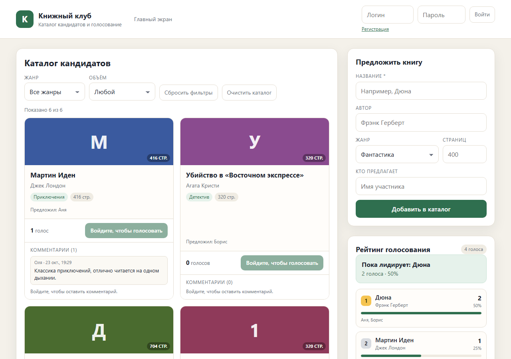
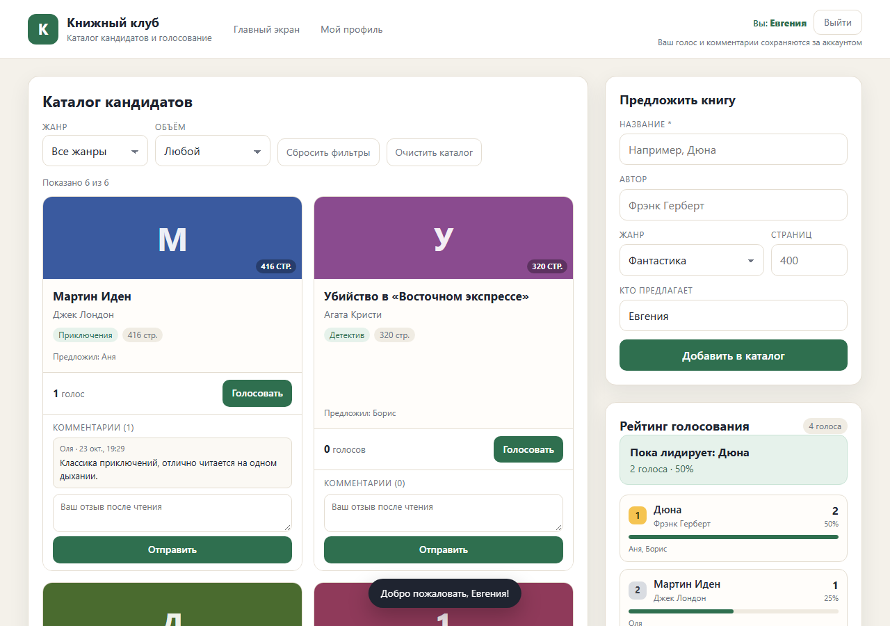
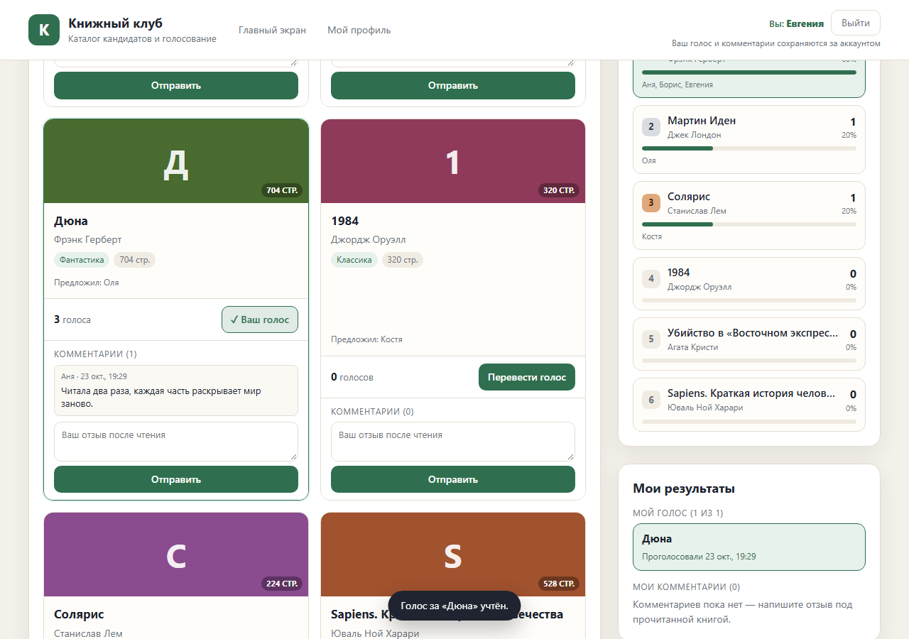
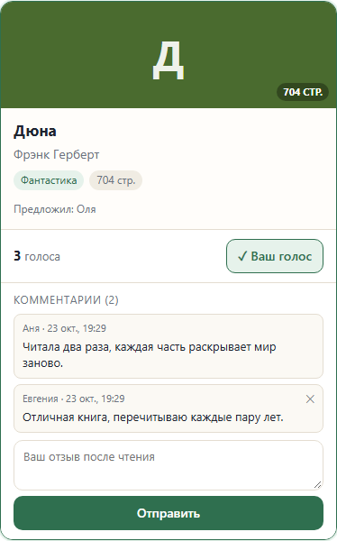
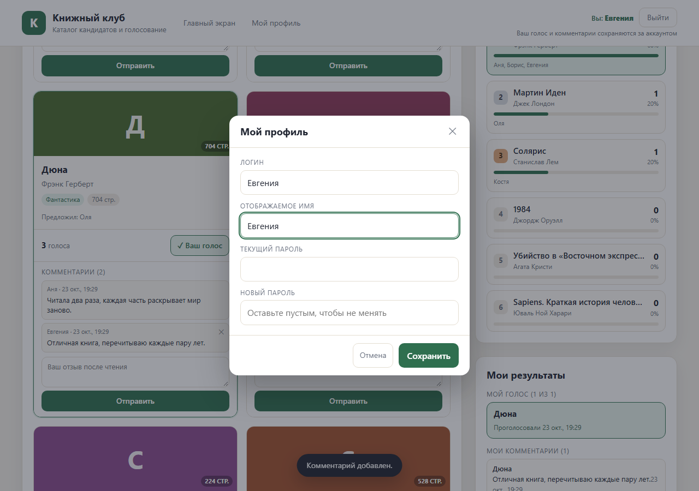
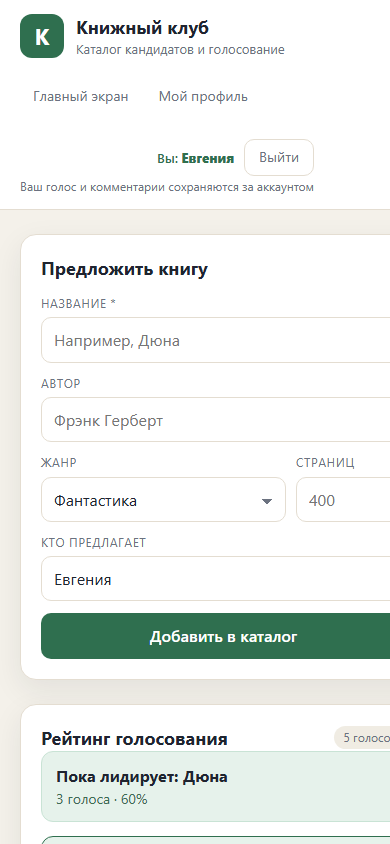
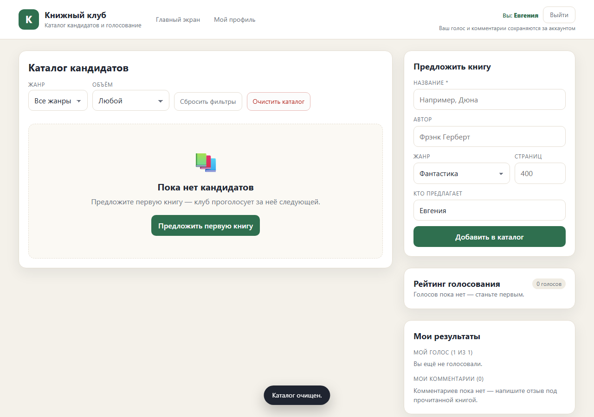

# Кейс: подборщик следующей книги для книжного клуба

**Срок:** одна неделя (~8–10 часов)
**Стек:** HTML / CSS / JavaScript + localStorage (демо-режим из ТЗ)
**Репозиторий:** https://github.com/Jennya2981/book-club
**Демо:** https://jennya2981.github.io/book-club/

## Задача

Участники книжного клуба долго выбирают следующую книгу в чате: десятки сообщений, а итога нет. Нужен сервис, где участник предлагает книгу, голосует один раз в пару кликов и сразу видит, что читать клубу следующим.

## Что сделано

- **Каталог кандидатов** — обложка-заглушка, автор, жанр, число страниц, кто предложил.
- **Фильтры** — по жанру и объёму (до 300 / 301–500 / 500+ страниц), кнопка «Сбросить фильтры».
- **Форма предложения книги** — с валидацией: без названия не добавить, число страниц — только число от 1 до 9999.
- **Голосование** — правило «один участник — один голос», рейтинг пересчитывается мгновенно.
- **Регистрация и вход** — логин и пароль (SHA-256), персональные данные и результаты.
- **Комментарии** — отзывы к книгам после чтения, удаление своих комментариев.
- **Мой профиль** — отображаемое имя и смена пароля.
- **Пустое состояние** — понятная подсказка «Предложите первую книгу».

## Как защищён один голос

1. Ключ участника — нормализованный логин: «Женя», «женя », «ЖЕНЯ» — один участник.
2. Голос пишет ровно одна функция `castVote()`: перед записью перечитывает хранилище, проверяет ключ и пишет в одном месте — обойти проверку из интерфейса нельзя.
3. На время записи кнопки блокируются — двойной клик не создаёт второй голос.
4. Смена голоса — только через явное подтверждение, итог всё равно один голос на участника.
5. Вкладки синхронизируются через событие `storage`.

## Проверка критериев

| Критерий | Результат |
|---|---|
| Один участник голосует только один раз | ✅ повтор — отказ «Вы уже проголосовали», смена голоса с подтверждением |
| Рейтинг пересчитывается сразу после голоса | ✅ счётчики, доля и лидер обновляются в тот же момент |
| Фильтр по жанру работает и сбрасывается | ✅ жанр + объём, кнопка сброса и «Главный экран» |
| Пустой каталог показывает «Предложите первую книгу» | ✅ после очистки каталога |
| Нельзя добавить книгу без названия | ✅ ошибка «Нельзя добавить книгу без названия» |

Дополнительно проверено: сохранение после перезагрузки страницы, перевод голоса на другую книгу (итог — по-прежнему 1 голос), регистрация → голос → комментарий → «Мои результаты».

## Скриншоты

### 1. Каталог кандидатов с фильтрами и рейтингом

### 2. Участник зарегистрировался — шапка показывает аккаунт

### 3. Голос учтён: кнопка «✓ Ваш голос», рейтинг и «Мои результаты» обновились

### 4. Комментарий к прочитанной книге

### 5. Мой профиль: отображаемое имя и смена пароля

### 6. Мобильная версия (390 px)

### 7. Пустое состояние каталога

## Как открыть

- Ссылка: https://jennya2981.github.io/book-club/
- Или локально: `python -m http.server 8765` в папке проекта → http://localhost:8765
- Данные хранятся в браузере (`localStorage`); «Очистить каталог» вернёт пустое состояние, обновление страницы вернёт демо-данные при первом заходе.

## Ограничения и следующий шаг

Демо-режим: голоса видны только в том браузере, где они сделаны. Для реального клуба с голосованием с разных устройств нужен серверный режим — в ТЗ рекомендован Python + Streamlit + SQLite; логика голосования и нормализация имени переносятся без изменений. ИИ-аннотация книги (по желанию в ТЗ) не реализовывалась.
